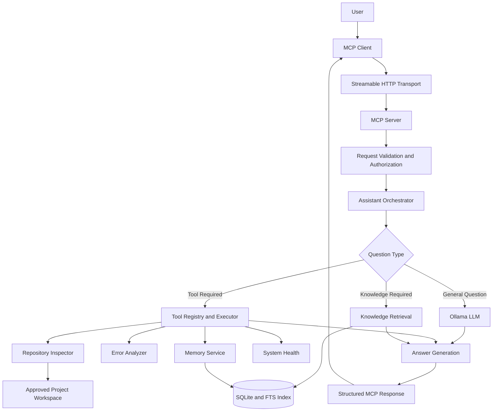

# Alexa MCP — Local-First AI Assistant

A backend-first AI assistant that connects natural-language questions to Model Context Protocol (MCP) tools. Designed to answer questions intelligently, retrieve relevant local knowledge, execute validated tools, and use a local LLM through Ollama.

> **Status:** Update this README to reflect the features actually implemented and tested in the repository.

## Features

- **Natural-language question answering** — answer questions directly or use relevant tools.
- **MCP integration** — expose backend capabilities to compatible MCP clients.
- **Local AI** — use Ollama without requiring paid LLM APIs.
- **Tool orchestration** — select, validate, and execute relevant tools.
- **Knowledge retrieval** — search configured local documents and ground answers in evidence.
- **Persistent memory** — store and retrieve explicitly requested preferences.
- **SQLite storage** — lightweight local persistence.
- **Security-first design** — input validation, access controls, execution limits, and safe error handling.
- **Backend only** — no frontend or dashboard required.

## Architecture



## Technology Stack

| Technology | Purpose |
|---|---|
| TypeScript | Type-safe backend development |
| Node.js | Runtime |
| Model Context Protocol | AI tool integration |
| MCP TypeScript SDK | MCP server implementation |
| Ollama | Local LLM inference |
| SQLite | Persistent storage |
| Zod | Input and configuration validation |
| Vitest | Automated testing, if configured |

Use the actual versions and packages defined by the repository's `package.json` and lockfile.

## Project Structure

The following is a suggested architecture. Adapt it to the existing implementation.

```text
alexa-mcp/
├── src/
│   ├── server/
│   │   ├── create-server.ts
│   │   └── transport.ts
│   ├── config/
│   │   └── env.ts
│   ├── core/
│   │   ├── assistant.ts
│   │   └── orchestrator.ts
│   ├── providers/
│   │   └── ollama/
│   ├── mcp/
│   │   └── register-tools.ts
│   ├── tools/
│   │   ├── registry.ts
│   │   └── definitions/
│   ├── retrieval/
│   ├── memory/
│   ├── storage/
│   └── security/
├── tests/
│   ├── unit/
│   ├── integration/
│   └── security/
├── docs/
├── .env.example
├── .gitignore
├── package.json
├── tsconfig.json
└── README.md
```

## Getting Started

### Prerequisites

- Node.js version supported by the project.
- npm or the package manager specified by the repository.
- Git.
- Ollama, if using local model inference.

### 1. Clone the repository

```bash
git clone <YOUR_REPOSITORY_URL>
cd <YOUR_REPOSITORY_DIRECTORY>
```

### 2. Install dependencies

For an npm project with a committed `package-lock.json`:

```bash
npm ci
```

Otherwise, use the package manager and installation command appropriate for the repository.

### 3. Configure environment variables

If `.env.example` exists:

```bash
cp .env.example .env
```

Edit `.env` using the environment variable names supported by the application.

Never commit credentials, tokens, or private configuration.

### 4. Set up Ollama

Install Ollama from:

https://ollama.com/download

Pull a compatible model. For example:

```bash
ollama pull qwen2.5:7b
```

This is an example model, not a mandatory choice. Select a model appropriate for your hardware and the capabilities you need.

Configure the Ollama URL and model name using the variables supported by your project.

### 5. Start the server

Use the scripts actually defined in `package.json`. Common examples are:

```bash
npm run dev
```

For a production build, if the scripts are available:

```bash
npm run build
npm start
```

Check the server logs for the actual listening address and MCP endpoint.

## Connecting an MCP Client

Configure a compatible MCP client to connect to the server's Streamable HTTP endpoint.

Example configuration shape:

```json
{
  "mcpServers": {
    "alexa-mcp": {
      "url": "http://127.0.0.1:3000/mcp"
    }
  }
}
```

**Important:** Replace the URL with the actual endpoint exposed by your server. The example assumes port `3000` and path `/mcp`; these values must be verified against the implementation.

An MCP server is not automatically an Alexa skill. Confirm the requirements of your intended Alexa or Alexa+ integration separately.

## Example Questions

Depending on which tools are implemented, you could ask:

- What can you help me with?
- Explain the architecture of this repository.
- Inspect the project structure and summarize its components.
- Analyze this error message and suggest likely causes.
- Search the configured knowledge base for relevant information.
- Remember this project preference.
- Retrieve my saved project preferences.
- Check whether the database and model provider are available.

The assistant should use real evidence, report missing information, and never claim a tool succeeded when it failed.

## Core Components

### Assistant Orchestrator

Routes requests to direct model reasoning, knowledge retrieval, or tool execution. Limits the number of execution steps and handles failures safely.

### Ollama Provider

Connects to the configured local model and handles timeouts, unavailable models, and provider errors.

### MCP Server

Registers tools and exposes them through the MCP protocol using the transport supported by the implementation.

### Tool Registry

Validates tool arguments, checks permissions, applies execution limits, and invokes approved operations.

### Knowledge Retrieval

Indexes explicitly configured local documents, searches relevant content, and preserves source information for grounded answers.

### Persistent Memory

Stores explicitly requested preferences and facts. Supports retrieval and deletion without automatically saving every conversation.

### SQLite Storage

Persists structured application data, memory, and searchable document metadata.

## Security

- Validate all external inputs.
- Keep secrets out of source control.
- Restrict filesystem access to approved directories.
- Treat retrieved documents and tool results as untrusted input.
- Require authorization for protected operations.
- Apply request timeouts and execution limits.
- Require confirmation for destructive or externally consequential actions.
- Avoid logging secrets or sensitive conversations.
- Protect remote deployments with appropriate authentication and TLS.

Do not expose an unauthenticated development server to the public internet.

## Testing

Use the commands configured in `package.json`. Typical examples include:

```bash
npm run typecheck
npm run lint
npm test
npm run build
```

These commands must exist in the repository before they can be used.

Important test scenarios include:

- MCP initialization and tool discovery.
- Valid and invalid tool inputs.
- Direct question answering.
- Retrieval-assisted answering.
- Ollama unavailable or timing out.
- Memory persistence and deletion.
- Unauthorized tool invocation.
- Prompt-injection attempts in retrieved documents.
- Graceful shutdown and error handling.

Use mock model providers in ordinary automated tests where possible so CI does not require a running local model or paid API.

## Configuration

Document the exact environment variables in `.env.example` and `docs/CONFIGURATION.md`.

Common configuration categories include:

| Setting | Purpose |
|---|---|
| Server host and port | HTTP listener configuration |
| Ollama URL | Local model service address |
| Model name | Selected local LLM |
| Database path | SQLite file location |
| Document directories | Approved knowledge sources |
| Request timeout | Maximum request duration |
| Tool execution limit | Bounds tool execution |
| Log level | Logging verbosity |
| Authentication | Remote access protection |

The table describes configuration categories rather than exact environment variable names. Use the actual names and defaults from the source code.

## Contributing

1. Inspect the existing implementation before changing it.
2. Keep pull requests focused.
3. Add tests for new functionality and bug fixes.
4. Run relevant checks before submitting a pull request.
5. Update documentation when behavior changes.
6. Report test failures and known limitations honestly.

Use descriptive commit messages. Do not create empty or artificial commits to inflate the Git history.

## License

Add the license that applies to this repository. Include the corresponding license file before claiming a specific open-source license.

---

**Note:** Keep this README synchronized with the actual implementation. Verify supported tools, commands, endpoint paths, configuration variables, and test results before publishing.
